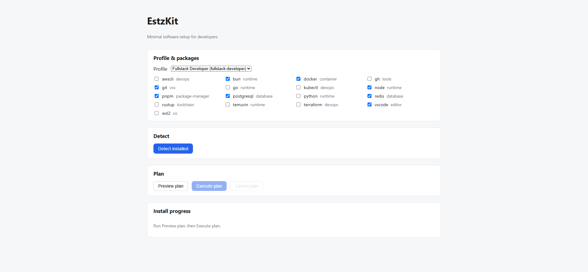
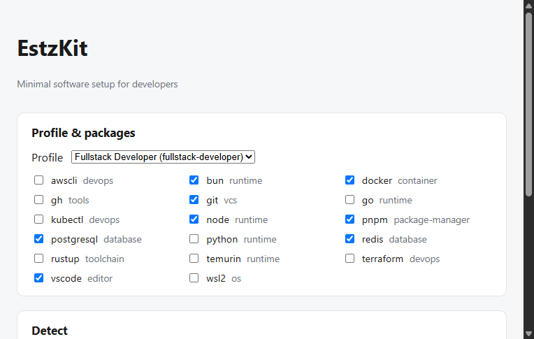
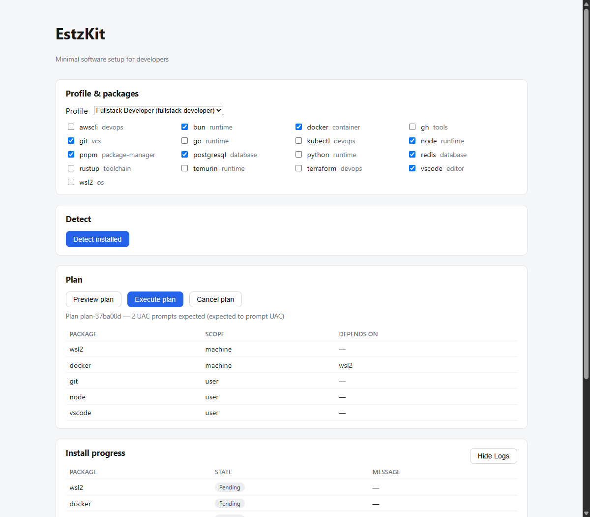

# EstzKit

Developer Workstation Installer / Orchestration Layer — a desktop app that installs a dev environment from declarative profiles (Fullstack, DevOps, Rust, ...) via the packages already on the machine (winget on Windows in MVP).

Status: **v0.1-rc** — Core installer engine, dependency resolver, SQLite resume engine, 17 packages, 3 profiles, and CI workflow in place.

## Stack (locked — see ADR)

| Layer | Choice |
|---|---|
| Desktop shell | Tauri v2 (runtime `tauri ~2.12` / build-time `tauri-build ~2.7` decoupled versioning) |
| Core logic | Rust 1.99 (`rust-toolchain.toml`), `crates/core` has no tauri dep |
| CLI | `crates/cli` (estzkit-cli) — vertical slice calling core directly |
| Frontend | React 19 + TypeScript 7.0.2, `src/`, types via ts-rs |
| Local state | SQLite (`rusqlite`, bundled) |
| Manifest source (MVP) | Bundled YAML + `ESTZKIT_MANIFESTS`/`--manifest-dir` override; Git registry in v2 |
| Elevation (MVP) | Standard user (option A); no `requireAdministrator` |
| Build package manager | pnpm 12 (`packageManager: pnpm@12.18.0`) |
| Provider (MVP) | Winget only, `--scope user` when supported |
| Install strategy (MVP) | `package_manager` only (no scripts) |

## Docs

- [System Design](docs/estzkit-system-design.md) — requirements, data flow, state machine, provider trait, error codes, security model
- [Tech Stack ADR](docs/estzkit-tech-stack-adr.md) — decisions ADR-001 … ADR-010, final stack, action items
- [VM Testing Playbook](docs/vm-testing-playbook.md) — manual & sandbox verification guide for exit codes and reboot-resume

## Layout

```
Cargo.toml          [workspace] members = ["crates/*", "src-tauri"]
rust-toolchain.toml  channel 1.99
pnpm-workspace.yaml  packages: ["."]
crates/
  core/             Rust library: manifest/, resolver, planner, executor, provider/, detect, verify, store — no tauri dep, emits via EventSink
  cli/              estzkit-cli: detect / profiles / packages / plan / install (core directly, stdout events)
src-tauri/          Tauri v2 host: IPC commands + events only (~thin adapter)
src/                React + TS UI (profile picker, package checklist, progress view)
manifests/          packages/*.yaml + profiles/*.yaml (bundled at build via rust-embed; ESTZKIT_MANIFESTS override)
schemas/            JSON Schemas: package.schema.json, profile.schema.json
scripts/            validate-manifests.mjs (ajv + js-yaml, runs in CI)
docs/               system design + ADRs
```

## Quick start

### Frontend & Manifest Validation

```bash
pnpm install
pnpm run validate:manifests   # validate packages & profiles against JSON Schemas
pnpm run dev                  # vite dev server (UI preview)
pnpm run tauri:build          # compile desktop app & produce .msi/.exe installer
```

### CLI (Headless Core)

`estzkit-cli` runs directly without webview/Tauri:

```bash
cargo run -p estzkit-cli -- packages              # list available manifests
cargo run -p estzkit-cli -- profiles              # list developer profiles
cargo run -p estzkit-cli -- detect                # probe installed packages on this machine
cargo run -p estzkit-cli -- plan node git docker  # preview dependency-ordered install plan
cargo run -p estzkit-cli -- install git node      # execute installation via winget
```

Unit tests (run in CI on `windows-latest` or locally):

```bash
cargo test -p estzkit-core
```

## Why not `winget configure`?

`winget configure` applies DSC (Desired State Configuration) YAML files directly. While useful for static environments, it leaves critical developer workflow gaps:

- **No profiles / dynamic curation:** Users must maintain manual DSC scripts rather than choosing composable profiles (e.g. Fullstack, DevOps, Rust).
- **No topological dependency resolution:** Does not resolve complex prerequisite orderings (such as enabling WSL2 before installing Docker Desktop).
- **No 3-state detection:** Only checks basic package presence, unable to differentiate `missing`, `installed_ok`, and `installed_version_mismatch` via active verification commands.
- **No verification loop:** Does not execute tool verification commands (`node --version`, `rustup --version`) or validate outputs against regular expressions.
- **No ACID resumability:** Cannot persist in-flight execution plans across unexpected interruptions or required system reboots.

EstzKit provides this reliability layer on top of native package managers (winget on Windows).

## Windows SmartScreen Notice (v0.1)

v0.1 installer builds are currently **unsigned** to keep the project open and free without upfront certificate costs.

When launching the installer (`.msi` / `.exe`), Windows Defender SmartScreen may display:

> **Windows protected your PC**  
> Microsoft Defender SmartScreen prevented an unrecognized app from starting.

**To run the installer:**
1. Click **More info**.
2. Click **Run anyway**.

EstzKit is non-commercial open source. Binary packages remain intentionally unsigned to keep the project completely free. If community sponsorship or funding permits, Azure Trusted Signing will be adopted for future release channels.

## Screenshots

### Profile & Package Selection


### Plan Preview & UAC Warnings


### Real-time Progress & Persisted Store Logs


## License

EstzKit is dual-licensed under:
- [MIT License](LICENSE-MIT)
- [Apache License 2.0](LICENSE-APACHE)

See [LICENSE](LICENSE) for details.
